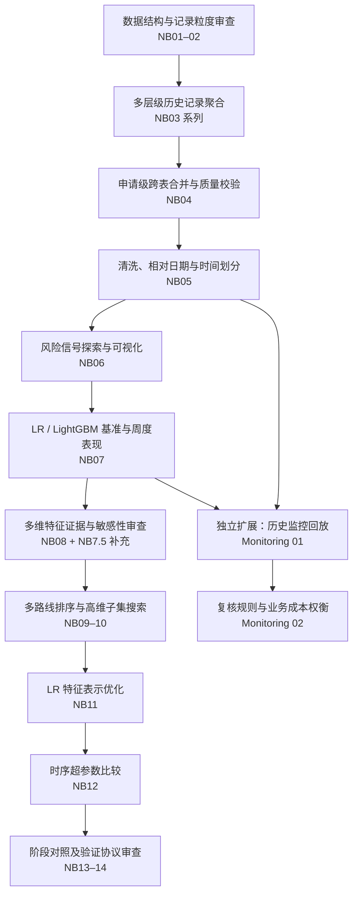
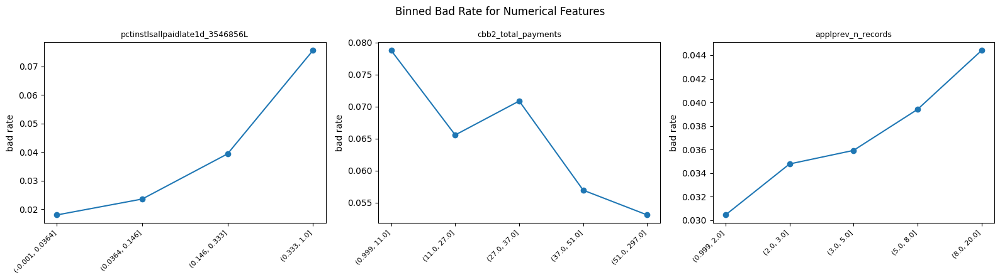
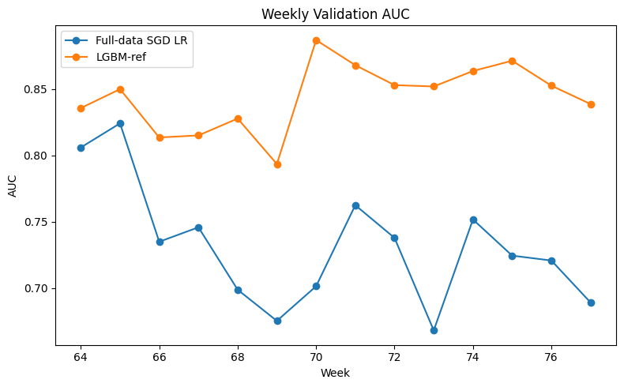
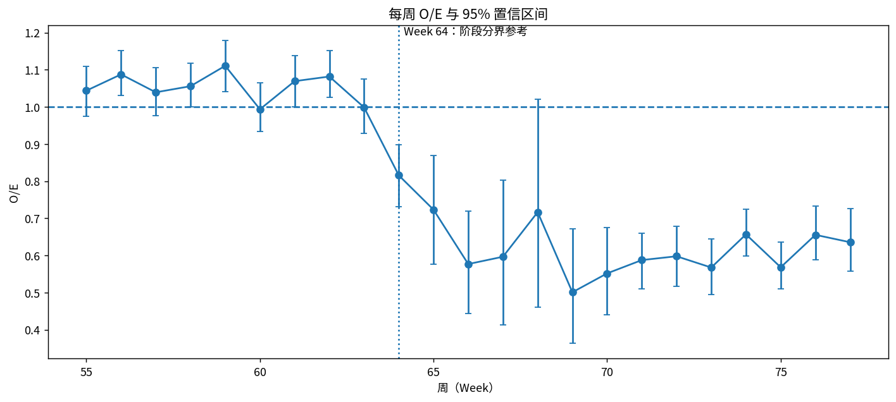

# Home Credit｜消费信贷违约风险建模与时间稳定性研究

> 基于 Kaggle **Home Credit – Credit Risk Model Stability** 数据集的端到端机器学习实验：从多表历史记录整理、申请级特征构建，到高维特征搜索、线性与树模型对比，再到跨时间验证及历史监控策略研究。

本项目尝试回答的核心问题不是“怎样让一次验证的 AUC 最高”，而是：**面对复杂、多层级、跨时间变化的信贷数据，如何建立可追溯的数据加工流程，选择有效且相对稳定的特征，并判断模型的预测表现能否经受时间变化的检验？**

**技术栈：** Python · Polars / Pandas · NumPy · Parquet / PyArrow · Scikit-learn · LightGBM · Matplotlib / Seaborn  
**数据来源：** [Kaggle — Home Credit: Credit Risk Model Stability](https://www.kaggle.com/competitions/home-credit-credit-risk-model-stability)  
**项目形式：** 以 Jupyter Notebook 为核心的建模与历史实验研究；不是已上线的信贷审批系统，也不代表取得 Kaggle 官方竞赛排名。

## 01｜项目概览

Home Credit 数据由申请主表、历史贷款、征信、税务、账户及人员等不同层级的记录组成。原始表间存在大量一对多关系，不能直接把全部明细按 `case_id` 连接后交给模型。本项目围绕四个连续问题展开：

1. **数据如何变成可建模样本？** 理清 17 张逻辑业务表及其记录粒度，分层聚合约 1.88 亿条历史记录，形成约 128 万条训练期申请样本，并建立字段来源与清洗规则。
2. **上千个特征如何筛选？** 对候选变量同时考察覆盖率、预测关联、冗余、模型贡献、交互线索和跨期可靠性，避免只依据单次特征重要性做选择。
3. **怎样验证优化确实有效？** 以 Logistic Regression 和 LightGBM 为两条对照路线，逐步比较特征子集、特征表示和超参数，并审查不同实验是否使用了公平一致的时间验证协议。
4. **模型运行后怎样发现失准？** 在独立的历史回放研究中，观察校准变化，比较预警灵敏度、复核次数与等待期间的业务暴露之间的取舍。

上述数量为当前项目整理口径；`1,209` 指进入基准建模候选池的原始特征数量，而非全部表连接后未经筛选的字段数量。

## 02｜整体工作流



**时间约束：** 主线建模开发使用 `WEEK_NUM 0–63`；`64–77` 用于后续验证与候选配置选择；`78–91` 作为预留的 OOT（Out-of-Time）区间。**本仓库不宣称已经获得独立 OOT 最终成绩。** 其中 NB10、NB12 的内部时间折只属于开发期搜索；NB14 在验证集上选模，其结果不能再视为独立测试成绩。

## 03｜Notebook 导览：每一步解决什么问题？

### A. 数据结构、聚合与建模样本（NB01–05）

| 阶段 | 需要解决的问题 | 方法与阶段产出 |
|---|---|---|
| **NB01｜数据表结构分析** | 原始文件分片与业务表不是一一对应；不同表的一行究竟代表什么？ | 扫描 Parquet schema、归并物理分片，核查业务主键与关联关系；形成逻辑表元数据，为后续处理建立可靠入口。 |
| **NB02｜聚合前质量排查** | 多记录表是否可以直接按申请合并？高缺失、重复和日期字段应怎样理解？ | 逐表检查缺失、取值、重复记录、`case_id` 与嵌套键，判断静态表、实体表和历史明细表各自需要的加工方式。 |
| **NB03 第一部分｜贷款与征信表聚合** | 历史贷款、征信记录和偿还流水的层级不一致，怎样压缩为单笔申请可用的特征？ | 对 `static`、`applprev`、`credit_bureau` 等来源按实际记录层级聚合，提取历史记录次数、金额、还款及时间统计，并补充申请主表特征。 |
| **NB03 第二部分 a｜账户与人员特征** | 存款、借记卡及关联人员有不同的实体键，如何保留多实体信息？ | 处理 `debitcard_1`、`deposit_1`、`other_1`、`person_1`，汇总账户金额、实体数量、申请人信息及部分人员特征。 |
| **NB03 第二部分 b｜嵌套人员与税务历史** | 人员下还嵌套明细，税务交易又带有日期和雇主维度，怎样防止重复合并和信息损失？ | 对 `person_2` 先聚合人员再归并申请，对 `tax_registry_a/b/c` 按雇主、日期和最近 30/90/180 天窗口生成申请级特征。 |
| **[NB04｜跨表合并](notebooks%28Jing%29/04_feature_join.ipynb)** | 上游各表的聚合结果怎样安全合成统一的申请级宽表？ | 用 `case_id` 做受约束的 LEFT JOIN，检查主键唯一性、行数守恒、Train/Test schema 和缺失；输出宽表与字段来源目录。 |
| **[NB05｜清洗与时间切分](notebooks%28Jing%29/05_preprocessing_temporal_split.ipynb)** | 怎样避免清洗规则从未来数据中偷看信息，并让各期样本使用同一规则？ | 只用开发期训练数据确定全空／常量字段处理规则，将日期改为相对申请日的时间差，固定 Train／Validation／OOT 边界并保存清洗配置。 |

**阶段成果：** 将多层级历史记录变为以申请为单位、结构一致、可溯源并具备时间边界的建模输入。NB03 的三个分册承担不同来源的聚合工作，属于同一数据处理阶段。

### B. 探索性分析与参考模型（NB06–07）

| 阶段 | 需要解决的问题 | 方法与阶段产出 |
|---|---|---|
| **[NB06｜探索性数据分析](notebooks%28Jing%29/06_exploratory_data_analysis.ipynb)** | 哪些变量可能包含风险信号？缺失、极端值、类别结构与坏账率有什么关系？ | 对代表性字段做分布、缺失、分箱坏账率、类别分层及相关性分析；为后续候选特征评估提供直觉与质量检查依据，而非据此直接断言特征有效。 |
| **[NB07｜LR 与 LightGBM 基准](notebooks%28Jing%29/07_baseline_lr_lightgbm.ipynb)** | 在复杂的混合类型数据上，线性模型与非线性模型各能做到什么程度？ | 构建分批读取、数值预处理和类别编码流程，训练 SGD Logistic Regression 与 LightGBM 参考模型，查看 AUC、概率校准、特征贡献和逐周表现，为后续优化提供对照线。 |

**代表性可视化：训练期分箱坏账率。** 对数值特征按取值区间分组，观察风险关系是否可能呈现非线性或非单调结构。图选自 NB06；它反映样本中的探索性现象，不是因果关系证据。



**代表性可视化：基准模型的逐周 Validation AUC。** 即使总体 AUC 看似稳定，不同周之间的表现也可能差异明显。图选自 NB07；需结合 NB13–14 中的验证使用审查理解，不能将不同实验直接当作公平排行榜。



### C. 特征证据、排序与子集搜索（NB08–10，含补充审查）

| 阶段 | 需要解决的问题 | 方法与阶段产出 |
|---|---|---|
| **[NB08｜特征证据画像](notebooks%28Jing%29/08_feature_evidence_profiling.ipynb)** | 一个变量“有用”的证据能否只看重要性排名？ | 汇合覆盖与质量、单变量关联、冗余、模型贡献、交互潜力及时间稳定性，形成候选特征的多维证据画像。 |
| **[NB7.5｜证据参数敏感性审查](notebooks%28Jing%29/08a_evidence_sensitivity_audit.ipynb)** | 类别压缩阈值、IV 分组方式一改变，证据和排序是否就会变化？ | 对关键统计口径进行敏感性对照，检查 Top-k 与排序稳定性。此为 NB08 的补充审查，**建议在 NB08 之后阅读**。 |
| **[NB09｜多路线特征排序](notebooks%28Jing%29/09_ranking_routes_robustness.ipynb)** | 预测相关性、冗余控制与模型偏好互相冲突，应该遵循哪一种排名？ | 为 LR 与 LightGBM 构造不同排序路线，比较路线重合度、参数定义敏感性及计算预算，给后续搜索提供可比较的候选序列。 |
| **[NB10｜特征子集搜索](notebooks%28Jing%29/10_feature_subset_search.ipynb)** | 上千个候选变量的全部组合无法穷举，选多少、选哪些才划算？ | 采用粗粒度深度扫描、边界检查、精细搜索和有限局部调整；利用开发期 F1–F4 时间折及 Pareto／平台区间思想比较性能、复杂度与稳健性。 |

**阶段成果：** 从“单一重要性排名”转为“多种证据 → 多条候选路线 → 分阶段验证”的可解释搜索框架；输出下游可继续使用的特征子集，而非只给出一张静态排名表。

### D. 特征表示、超参数与验证协议（NB11–14）

| 阶段 | 需要解决的问题 | 方法与阶段产出 |
|---|---|---|
| **[NB11｜LR 特征表示搜索](notebooks%28Jing%29/11_lr_representation_search.ipynb)** | 线性模型受到表达能力限制，筛选后的原始字段是否需要非线性变换？ | 比较原始特征、局部工程变换及 PCA；按计算预算逐层筛查、组装候选表示，并以开发期时间折检验跨期表现。冻结的是表示方案，不是最终模型。 |
| **[NB12｜时序超参数搜索](notebooks%28Jing%29/12_temporal_hyperparameter_search.ipynb)** | 在特征路线大致确定后，如何平衡模型表现、复杂度和跨期波动？ | 以有约束的候选配置比较 LR 与 LightGBM，区分 AUC 优先和稳健性优先的选择策略。原始运行中手动最终冻结步骤未启用，须按保存记录理解完成范围。 |
| **[NB13｜三阶段验证对比](notebooks%28Jing%29/13_validation_stage_comparison.ipynb)** | 基准、特征筛选和调参分别贡献了什么？不同模型的收益是否一致？ | 将 LR 与 LightGBM 的基准、筛选后及调参后表现放在统一对照表中，识别“优化不一定总会提高验证表现”的情况。 |
| **[NB14｜验证协议审查与配置选择](notebooks%28Jing%29/14_validation_model_selection.ipynb)** | 如果历史基准与新实验使用验证集的方式不一致，比较是否公平？ | 审查早停与验证暴露的差异，在明确的 Validation 窗口内重新比较部分特征集和参数配置，记录被选方案与方法限制。该窗口用于选模，不是独立 OOT 测试。 |

**阶段成果：** 建立从“原始特征”到“表示方法、训练配置和协议审查”的完整实验链条。项目记录了有效改进，也保留未超过基准的方案和实验协议差异，避免选择性展示结果。

### E. 独立扩展：历史监控与复核策略（Monitoring 01–02）

这条研究分支基于 NB05 的清洗结果与 NB07 的 LightGBM 参考配置，**不是直接把 NB14 最终选定模型投入生产**；它模拟历史时点的模型冻结、后续观察和复核决策。

| Notebook | 需要解决的问题 | 方法与阶段产出 |
|---|---|---|
| **[Monitoring 01｜历史回测与校准监控](notebooks%28Jing%29/model_monitoring/monitoring_01_historical_backtest.ipynb)** | 一个模型可能仍能区分高低风险，但预测出的违约概率已经失准，怎样及时发现？ | 模拟 Week 55 冻结模型并逐周回放至 Week 77；观察 O/E、AUC、Bootstrap 区间和校准曲线，估算等待判断期间经过模型的申请量。 |
| **[Monitoring 02｜复核规则与成本权衡](notebooks%28Jing%29/model_monitoring/monitoring_02_review_policy_tradeoffs.ipynb)** | 监控出现异常后立即复核，还是等待更多证据？ | 基于 PSI、平均预测概率、高风险占比及申请量变化制定 90 条候选规则；通过历史回放和 Pareto 分析比较误复核次数与等待暴露。 |

**代表性可视化：历史回放中的周度 O/E 与置信区间。** O/E 为实际违约率与平均预测违约概率之比；偏离 1 反映概率校准偏差。虚线为模拟研究中识别的 Week 64 历史变化点，不代表事前已准确预测该变化。



**阶段成果：** 不仅观察模型是否失准，还进一步分析“怎样把监控信号变成可执行的复核规则，以及行动过早与过晚各有什么代价”。这里的申请量是业务暴露代理指标，不能直接等同于损失金额。

## 04｜仓库目录与阅读建议

```text
homecredit/
├── README.md                         # 本项目首页与 Notebook 导航
├── .gitignore                        # 忽略大型数据、缓存等文件
├── KAGGLE_SETUP.md                   # Kaggle 数据与运行环境准备说明
├── requirements.txt                  # Python 依赖列表
├── figures/                          # README 使用的示例图，不必重复所有输出
│   ├── eda_risk_bins.png
│   ├── baseline_weekly_auc_comparison.png
│   └── monitoring_weekly_oe.png
└── notebooks(Jing)/                  # Jupyter Notebook 与保存的运行输出
    ├── [现有 NB01–03 原文件及分册]
    ├── 04_feature_join.ipynb
    ├── 05_preprocessing_temporal_split.ipynb
    ├── 06_exploratory_data_analysis.ipynb
    ├── 07_baseline_lr_lightgbm.ipynb
    ├── 08_feature_evidence_profiling.ipynb
    ├── 08a_evidence_sensitivity_audit.ipynb
    ├── 09_ranking_routes_robustness.ipynb
    ├── 10_feature_subset_search.ipynb
    ├── 11_lr_representation_search.ipynb
    ├── 12_temporal_hyperparameter_search.ipynb
    ├── 13_validation_stage_comparison.ipynb
    ├── 14_validation_model_selection.ipynb
    └── model_monitoring/
        ├── monitoring_01_historical_backtest.ipynb
        └── monitoring_02_review_policy_tradeoffs.ipynb
```

- **想了解数据工程过程：** 阅读 NB01–05，重点看不同明细粒度如何转换为申请级特征，以及怎样校验多表合并结果。
- **想了解特征筛选方法：** 阅读 NB08 → NB7.5 → NB09 → NB10，重点看证据体系、搜索预算与稳健性。
- **想了解模型实验：** 阅读 NB07 → NB11 → NB12 → NB13 → NB14，重点看基准、模型差异、特征表示和验证协议。
- **想了解风险监控与业务决策：** 阅读 Monitoring 01 → Monitoring 02，重点看失准证据、触发逻辑和复核成本。

> **文件名说明：** NB7.5 是实验中的补充审查编号；为便于 GitHub 按文件名排序，其整理版命名为 `08a_...`。主线 NB03 的若干原始分册沿用仓库现有命名。上面的链接以本 README 所列目标目录为准，若上传时采用其他文件夹或文件名，请同步修改链接。

## 05｜项目组织与运行说明

### 为什么以 Notebook 为主体？

本项目属于**数据科学与机器学习实验研究**，而非需要部署的 Web 服务或生产系统。因此按照“问题—方法—验证结果”组织 Jupyter Notebook：每本保留该阶段的数据处理或模型代码、实验设置、关键分析与**已保存的运行输出**。读者可以直接在 GitHub 查看图表、统计表和指标，无需先运行整套流水线。

仓库目前没有专门拆分 `src/`、`scripts/`、`models/` 等工程目录；这与当前的项目形态相符，不代表已有可一键部署的服务。后续如果增加可复用的独立模块或自动化流水线，再根据实际代码结构拆分即可。

| 仓库组成 | 主要用途 |
|---|---|
| `notebooks(Jing)/` | 项目主体，按数据聚合、特征工程、模型搜索与验证排列 Notebook，并保留原实验输出。 |
| `notebooks(Jing)/model_monitoring/` | 历史回放与复核规则的独立研究扩展。 |
| `figures/` | 放置三张从已保存运行结果中选出的示例图，用于 README 的快速浏览；完整图表仍在 Notebook 中。 |
| `README.md` | 提供问题导向的实验地图、Notebook 索引、运行与验证边界。 |
| `requirements.txt`、`KAGGLE_SETUP.md` | 记录依赖与数据准备说明；具体环境和路径仍需根据实际运行条件调整。 |
| `.gitignore` | 避免把大型数据文件、缓存及无关中间产物加入仓库。 |

### 数据、运行环境和复现边界

1. **数据来源与隐私：** 原始数据来自 [Kaggle 竞赛](https://www.kaggle.com/competitions/home-credit-credit-risk-model-stability)。仓库不包含完整竞赛数据、衍生的大体积 Parquet 文件和个人 Google Drive 数据；使用者需自行下载并按照竞赛要求使用。
2. **Notebook 依赖关系：** 建议先阅读 NB01–05 的数据检查、聚合、合并与清洗，再查看 EDA、特征搜索和模型比较。部分步骤依赖前序 Notebook 已生成的中间表、配置或 checkpoint；模型监控扩展则有独立的历史回测输入与输出依赖。
3. **输出保留原则：** `.ipynb` 包含已保存的图表、数据表、评估指标和运行日志，方便直接审阅。**保存了输出，不等于在全新环境中能无需准备数据而一键复现**；本仓库不作此保证。
4. **研究与公开边界：** 当前结果来自模型开发、验证集配置选择及历史模拟研究，不能替代独立 OOT 评估，更不代表已经部署生产系统。

## 06｜结论与局限

本项目最重要的收获是把信贷风险建模拆解为一系列**可检验的问题**：从记录粒度与数据泄露风险，到高维特征证据、模型表示能力、搜索预算、时间验证，以及监控信号如何支持后续决策。部分模型优化取得改进，部分搜索结果没有超越基准；这些差异都是实验结论的一部分。

仍需注意：特征选择与调参涉及多轮开发期评估；NB14 使用验证窗口作配置选择，因此其结果不等于独立泛化估计；监控分支是基于历史数据的回顾性模拟，不能直接外推到真实生产环境。**后续若开展独立 OOT 评估，应以冻结后的方案、未参与选模的数据和一致的比较协议为前提。**
